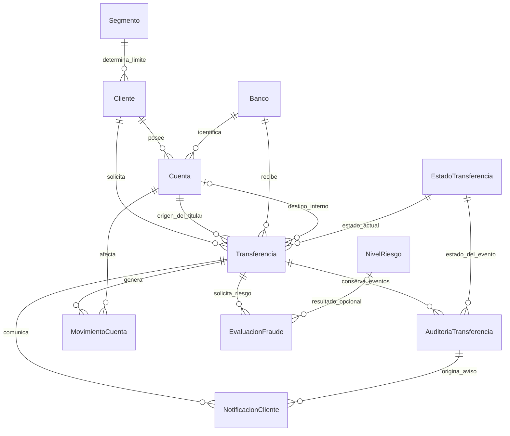

# Modelo ER de Clean Transferencia

Destino exclusivo: **BD_Equipo2**, esquema **transferencias**. Fecha de creación: 17 de octubre de 2026.

## Alcance

Este modelo se utiliza mediante EF para el core del taller, auditoría y límites. Contiene 11 tablas, 84 columnas y 95 descripciones de tabla/columna. Consulta [la guía de configuración](../README.md) para conectar exclusivamente a `BD_Equipo2`. La API utiliza SQL; las pruebas predeterminadas sustituyen el almacenamiento. La base permanece en el servidor compartido y este directorio no contiene sus datos ni respaldos.

El script de demostración contiene datos ficticios: Ana Demo y Luis Demo, cuentas 001, 002 y 003 y bancos BANCO_A y BANCO_B. No es una exportación de la BD compartida. Ese script no crea movimientos ni transferencias; no debe confundirse con el contenido actual del servidor.

## Archivos y orden de ejecución

Para estudiar el modelo, usar `database/scriptPrincipal-modeloer.sql`: versión organizada por catálogos, entidades, operación, seguimiento e índices. Conserva las mismas tablas, claves y restricciones del script original; omite las llamadas repetitivas que almacenan las descripciones. Las descripciones ya existentes en SQL Server no cambian al editar un archivo. La creación completa con sus propiedades extendidas permanece en `001_crear_modelo.sql`.

1. `database/001_crear_modelo.sql`: crea las tablas, claves, restricciones, índices y comentarios. Una transacción agrupa la creación. Se detiene si la base actual no es BD_Equipo2 o si el esquema ya contiene objetos; no recrea ni elimina tablas.
2. `database/002_datos_demostracion.sql`: inserta catálogos y datos ficticios que faltan; no modifica filas existentes.
3. `database/003_verificar_modelo.sql`: consultas de solo lectura para revisar estructura, relaciones, comentarios y cuentas.
4. `database/004_pruebas_integridad.sql`: pruebas transaccionales de restricciones; las filas de prueba se revierten. Los contadores IDENTITY pueden avanzar y dejar huecos.
5. `database/modelo-er.mmd`: diagrama editable en Mermaid.
6. `database/modelo-er.svg` y `database/modelo-er.png`: representación visual de las once tablas y sus claves. El SVG permite ampliar sin perder nitidez. `modelo-er.dot` conserva la fuente del gráfico; las claves compuestas completas están en el SQL.

Resultado comprobado el 17 de octubre de 2026: 11 tablas, 84 columnas, 16 claves foráneas y 95 descripciones. Las 15 pruebas de integridad finalizaron correctamente, sin transacciones abiertas, y revirtieron las operaciones y cambios de saldo utilizados por la prueba. Los huecos de IDENTITY que puedan observarse son normales tras esas reversiones.

Para ejecutar desde SSMS, seleccionar BD_Equipo2 antes de abrir cada script. Los guardas de cada archivo impiden su ejecución en otra base. El permiso del login para crear tablas y esquemas se comprobó en la sesión abierta; no se guardaron credenciales en el proyecto.

## Diagrama de relaciones

La FK de origen incluye cliente y cuenta para impedir registrar una transferencia a nombre de un titular distinto. La FK opcional de destino interno incluye cuenta, banco y número. Las cuentas de otros bancos no se crean en Cuenta: se conservan su banco y su número en Transferencia.

## Decisiones para revisar

- **Moneda**: el alcance actual es PEN. No se implementó cambio de moneda; una ampliación exige revisar cuentas, límites y reglas.
- **Dinero**: se usa decimal(18,2); los números de cuenta y el DNI son texto para mantener ceros iniciales.
- **Estados y riesgo**: se conserva el valor numérico actual de los enums. Renombrar o reordenar enums requiere revisar el mapeo EF.
- **Comisión**: CalculadoraDeComision y Reglas permanecen en Domain. No son tablas. Se conserva la comisión aplicada a cada operación para no recalcular el historial si cambia una regla.
- **Tiempos**: datetimeoffset conserva el instante; los valores por defecto se generan en UTC. FechaNegocio se calcula con UTC-5 para el día de Lima.
- **Concurrencia**: Cuenta, Transferencia, EvaluacionFraude y NotificacionCliente incluyen rowversion. Es un token binario, no una fecha. EF lo configura como token de concurrencia.
- **Reintentos**: el GUID de la solicitud es la PK de Transferencia. Los movimientos tienen unicidad por operación, cuenta y concepto. El repositorio debe comparar los datos de una solicitud repetida antes de reutilizar su resultado.
- **Saldo y límite**: las restricciones de tablas no ejecutan transferencias ni garantizan por sí solas el límite acumulado. El débito, el movimiento y la comprobación del límite requieren una misma unidad transaccional con bloqueo o control de concurrencia adecuado. EF no debe depender del semáforo local.
- **Acumulado diario**: deriva de DEBITO_MONTO y los reversos confirmados de esos mismos débitos, agrupado por cliente y día del movimiento en Lima. FechaNegocio conserva el día de solicitud; confirmar OTP después puede mover dinero otro día. Una operación pendiente puede haber debitado.
- **Saldo inicial**: los datos de prueba parten de un saldo de apertura. No debe reconstruirse ese saldo sumando solo los movimientos de transferencia de este modelo.
- **Conciliación**: no se reembolsa por un timeout sin verificar al proveedor. Los tipos REVERSO requieren una decisión confirmada.
- **Fraude**: EstadoEvaluacion distingue Pendiente/Procesando/Completada/Error. El nivel de riesgo queda nulo hasta tener una respuesta válida. Esta tabla prepara el batch, pero no lo ejecuta.
- **Notificaciones**: cada aviso corresponde a un evento de auditoría y un canal. El worker, la toma exclusiva de trabajos y los reintentos son una implementación posterior.
- **Auditoría**: registrar el estado financiero y su evento en la misma transacción. El modelo permite conservar historial, pero no impone una política inmutable a las cuentas con permisos de escritura.
- **Rechazos previos a resolver entidades**: el handler registra esos rechazos en el log, sin insertar referencias inválidas ni inventar entidades. Un registro persistente separado de solicitudes inválidas queda como ampliación futura.
- **Integraciones**: aquí se modela el core local simulado. Si después se conecta un core bancario real, ese sistema será la autoridad del saldo y los movimientos.
- **JWT**: no se crean usuarios, contraseñas ni tokens. La API valida el claim national_id y lo relaciona con Cliente.Dni para restringir el acceso por titular.

## Correspondencia con el código actual

| Contrato o entidad | Tablas del modelo |
|---|---|
| Cliente / IConsultarClienteRepository | Cliente y Segmento |
| Cuenta / IConsultarCuentaRepository | Cuenta, Cliente y Banco |
| ICoreBancarioGateway | Cuenta, Transferencia y MovimientoCuenta |
| Transferencia / IAuditoriaRepository | Transferencia, EstadoTransferencia y AuditoriaTransferencia |
| ISegmentoLimiteRepository | Segmento |
| IAntifraudeService | EvaluacionFraude y NivelRiesgo |
| INotificadorCliente | NotificacionCliente |
| ICamaraCompensacionGateway | Conserva sus referencias y resultado en la transferencia y auditoría; el envío sigue siendo externo |
| IOtpService | Sin almacenamiento de OTP en texto. El proveedor de verificación aún debe definirse |

EF utiliza modelos `*Row` y mapeos hacia los records del dominio. EF permanece en Infrastructure. El handler tiene duración por solicitud; los repositorios crean contextos mediante `IDbContextFactory`, y el bloqueo SQL coordina la concurrencia entre instancias.

## Diccionario de datos

### Banco

Identifica el banco de cada cuenta y el banco receptor. Permite distinguir una transferencia interna de una interbancaria sin repetir nombres.

| Columna | Tipo | Explicación |
|---|---|---|
| BancoId | int IDENTITY(1,1) NOT NULL | Clave interna del banco. |
| Codigo | varchar(20) NOT NULL | Código estable utilizado por la API; por ejemplo BANCO_A. |
| Nombre | nvarchar(100) NOT NULL | Nombre descriptivo del banco. |
| EsBancoPropio | bit NOT NULL | Indica el banco local del taller; solo uno puede estar marcado. |
| Activo | bit NOT NULL | Permite deshabilitar un banco sin borrar su historial. |

### Segmento

Mantiene el límite diario por segmento que necesita ISegmentoLimiteRepository. Centraliza los valores Regular y Preferente.

| Columna | Tipo | Explicación |
|---|---|---|
| SegmentoId | int IDENTITY(1,1) NOT NULL | Clave interna del segmento. |
| Nombre | nvarchar(50) NOT NULL | Nombre que corresponde a Cliente.Segmento en el dominio. |
| LimiteDiario | decimal(18,2) NOT NULL | Monto principal máximo por cliente y día de Lima, sin incluir comisiones. |
| Activo | bit NOT NULL | Permite deshabilitar un segmento sin borrar clientes. |

### Cliente

Representa la entidad Cliente del dominio y relaciona la identidad de negocio con sus cuentas y su segmento.

| Columna | Tipo | Explicación |
|---|---|---|
| ClienteId | bigint IDENTITY(1,1) NOT NULL | Clave interna del cliente; independiente de su documento. |
| Dni | varchar(8) NOT NULL | Documento de ocho dígitos y clave de búsqueda del contrato actual. No es una contraseña. |
| Nombres | nvarchar(150) NOT NULL | Nombre completo usado por la entidad Cliente. |
| SegmentoId | int NOT NULL | Segmento que determina el límite diario. |
| Activo | bit NOT NULL | Estado administrativo; el adaptador EF deberá considerar este campo al consultar. |
| FechaCreacion | datetimeoffset(3) NOT NULL | Fecha de creación expresada en UTC. |

### Cuenta

Representa las cuentas que administra el core simulado. Conserva el saldo disponible y un token de concurrencia para detectar actualizaciones simultáneas.

| Columna | Tipo | Explicación |
|---|---|---|
| CuentaId | bigint IDENTITY(1,1) NOT NULL | Clave interna de la cuenta. |
| ClienteId | bigint NOT NULL | Titular de la cuenta. |
| BancoId | int NOT NULL | Banco al que pertenece. En este taller se registran aquí las cuentas locales. |
| NumeroCuenta | varchar(30) NOT NULL | Número tratado como texto para conservar ceros iniciales, como 001. |
| Activa | bit NOT NULL | Corresponde a Cuenta.Activa. |
| Moneda | char(3) NOT NULL | Alcance inicial: únicamente soles. El modelo no realiza conversión de moneda. |
| SaldoDisponible | decimal(18,2) NOT NULL | Saldo actual. Debe actualizarse en la misma transacción que registra el movimiento. |
| VersionFila | rowversion NOT NULL | Token binario de concurrencia para EF; no representa una fecha. |
| FechaCreacion | datetimeoffset(3) NOT NULL | Fecha de creación en UTC. |

### EstadoTransferencia

Catálogo que hace legibles los estados de la transferencia y conserva la correspondencia numérica con el enum actual del dominio.

| Columna | Tipo | Explicación |
|---|---|---|
| EstadoTransferenciaId | tinyint NOT NULL | Valor actual del enum: 0 Rechazada, 1 RequiereConfirmacion, 2 NoDisponible, 3 Pendiente, 4 Completada. |
| Nombre | varchar(30) NOT NULL | Nombre del estado actual del dominio. |
| Descripcion | nvarchar(250) NOT NULL | Explicación del estado para revisión del equipo. |

### NivelRiesgo

Catálogo de la respuesta de antifraude. Mantiene separados los resultados de riesgo y los estados financieros de una transferencia.

| Columna | Tipo | Explicación |
|---|---|---|
| NivelRiesgoId | tinyint NOT NULL | Valor del enum actual: 0 Bajo, 1 Medio, 2 Alto. |
| Nombre | varchar(20) NOT NULL | Nombre del nivel de riesgo. |
| Descripcion | nvarchar(250) NOT NULL | Interpretación del resultado para el taller. |

### Transferencia

Almacena cada solicitud y su último estado. El GUID recibido como TransactionReference es único y permite reconocer reintentos de la misma operación.

| Columna | Tipo | Explicación |
|---|---|---|
| TransferenciaId | uniqueidentifier NOT NULL | ID enviado por el consumidor. Debe conservarse en reintentos; no generar otro al repetir. |
| ClienteId | bigint NOT NULL | Cliente solicitante y titular obligatorio de la cuenta origen. |
| CuentaOrigenId | bigint NOT NULL | Cuenta local desde la que se solicita el débito. |
| BancoDestinoId | int NOT NULL | Banco receptor. |
| NumeroCuentaDestino | varchar(30) NOT NULL | Identificación del destino externo o interno; no exige que exista una cuenta externa localmente. |
| CuentaDestinoInternaId | bigint NULL | Referencia opcional cuando el destino está administrado por el core local. La FK comprueba banco y número. |
| Monto | decimal(18,2) NOT NULL | Monto principal que recibe el destino. |
| Comision | decimal(18,2) NOT NULL | Comisión calculada por el dominio y conservada como valor histórico. |
| TotalDebito | decimal calculado | Total solicitado al origen; campo calculado, no se envía desde EF al insertar. |
| Moneda | char(3) NOT NULL | Moneda única del taller: PEN. |
| FechaSolicitud | datetimeoffset(3) NOT NULL | Momento de la solicitud. Debe preservarse para conciliar y auditar. |
| FechaNegocio | date calculado | Día de Lima que agrupa el límite diario; calculado a partir de la solicitud. |
| EstadoTransferenciaId | tinyint NOT NULL | Estado actual. Debe indicarse explícitamente al crear la operación. |
| Mensaje | nvarchar(500) NOT NULL | Motivo del resultado; no incluir credenciales ni OTP. |
| Notificada | bit NOT NULL | Compatibilidad con el dominio actual; los intentos de entrega se registran aparte. |
| VersionFila | rowversion NOT NULL | Token de concurrencia para impedir que EF sobrescriba cambios de estado sin detectarlos. |

### AuditoriaTransferencia

Conserva el historial de estados sin depender solo de la última fila de Transferencia. Permite explicar rechazos, confirmaciones y resultados inciertos.

| Columna | Tipo | Explicación |
|---|---|---|
| AuditoriaTransferenciaId | bigint IDENTITY(1,1) NOT NULL | Secuencia del evento de auditoría. |
| TransferenciaId | uniqueidentifier NOT NULL | Operación auditada. |
| EstadoTransferenciaId | tinyint NOT NULL | Estado registrado en este evento. |
| FechaEvento | datetimeoffset(3) NOT NULL | Momento del evento en UTC. |
| Mensaje | nvarchar(500) NOT NULL | Descripción del evento y su motivo, sin datos secretos. |
| TraceIdentifier | nvarchar(100) NULL | Identificador de correlación de la solicitud; no contiene el token JWT. |
| Origen | nvarchar(100) NOT NULL | Componente o proceso que generó el evento. |

### MovimientoCuenta

Registra cada efecto sobre un saldo y separa monto, comisión y crédito interno. La unicidad impide registrar dos veces el mismo concepto para una cuenta y operación.

| Columna | Tipo | Explicación |
|---|---|---|
| MovimientoCuentaId | bigint IDENTITY(1,1) NOT NULL | Secuencia interna del movimiento. |
| TransferenciaId | uniqueidentifier NOT NULL | Operación que origina el movimiento. |
| CuentaId | bigint NOT NULL | Cuenta local afectada. |
| TipoMovimiento | varchar(20) NOT NULL | DEBITO_MONTO, DEBITO_COMISION, CREDITO_DESTINO o sus reversos. Un reverso necesita una decisión explícita de conciliación. |
| Naturaleza | char(1) NOT NULL | D disminuye el saldo; C lo incrementa. |
| Monto | decimal(18,2) NOT NULL | Valor positivo del movimiento. Una comisión cero no genera movimiento. |
| SaldoAnterior | decimal(18,2) NOT NULL | Saldo antes de aplicar este movimiento. |
| SaldoPosterior | decimal(18,2) NOT NULL | Saldo después del movimiento; el CHECK exige consistencia aritmética. |
| FechaMovimiento | datetimeoffset(3) NOT NULL | Momento de contabilización en UTC. |

### EvaluacionFraude

Prepara la persistencia de solicitudes y respuestas del futuro evaluador o batch. La falta de respuesta se distingue de un resultado de riesgo Bajo.

| Columna | Tipo | Explicación |
|---|---|---|
| EvaluacionFraudeId | bigint IDENTITY(1,1) NOT NULL | Secuencia de evaluación. |
| TransferenciaId | uniqueidentifier NOT NULL | Operación que debe evaluarse antes del débito. |
| NumeroIntento | int NOT NULL | Número de intento de evaluación dentro de la operación. |
| EstadoEvaluacion | varchar(12) NOT NULL | Pendiente, Procesando, Completada o Error. Es independiente del estado financiero. |
| NivelRiesgoId | tinyint NULL | Resultado del evaluador. Es obligatorio al completar y nulo mientras no exista un resultado. |
| Motivo | nvarchar(500) NULL | Razón de la decisión o del error; no guardar datos de autenticación. |
| VersionRegla | varchar(50) NOT NULL | Versión del conjunto de reglas utilizado; debe proporcionarla el evaluador. |
| Proveedor | nvarchar(100) NOT NULL | Identifica al script, batch o servicio que realiza la evaluación. |
| FechaSolicitud | datetimeoffset(3) NOT NULL | Fecha de creación de la solicitud de riesgo. |
| FechaRespuesta | datetimeoffset(3) NULL | Momento en que terminó la evaluación o se registró su error. |
| VersionFila | rowversion NOT NULL | Token para coordinar cambios de estado entre consumidores. |

### NotificacionCliente

Conserva los avisos por entregar para permitir reintentos sin cambiar el resultado financiero. Prepara el patrón de mensajes pendientes; el worker se implementará después.

| Columna | Tipo | Explicación |
|---|---|---|
| NotificacionClienteId | bigint IDENTITY(1,1) NOT NULL | Identificador del aviso. |
| TransferenciaId | uniqueidentifier NOT NULL | Operación que se comunica. |
| AuditoriaTransferenciaId | bigint NOT NULL | Evento preciso que originó el aviso. |
| Canal | varchar(10) NOT NULL | SMS o Correo; cada evento puede generar un aviso por canal. |
| EstadoEnvio | varchar(10) NOT NULL | Pendiente, Enviada o Error. |
| Intentos | int NOT NULL | Número de intentos de entrega. |
| FechaCreacion | datetimeoffset(3) NOT NULL | Momento de creación en UTC. |
| FechaEnvio | datetimeoffset(3) NULL | Fecha de aceptación por el proveedor; no prueba lectura por el cliente. |
| ProximoIntento | datetimeoffset(3) NULL | Momento propuesto para reintentar. |
| UltimoError | nvarchar(500) NULL | Resumen del error de entrega sin secretos. |
| VersionFila | rowversion NOT NULL | Token para coordinar reintentos entre consumidores. |

## Referencias técnicas

- [Propiedades extendidas y comentarios en SQL Server](https://learn.microsoft.com/en-us/sql/relational-databases/system-stored-procedures/sp-addextendedproperty-transact-sql).
- [Token rowversion](https://learn.microsoft.com/en-us/sql/t-sql/data-types/rowversion-transact-sql).
- [Configuración y ciclo de vida de DbContext](https://learn.microsoft.com/en-us/ef/core/dbcontext-configuration/).
