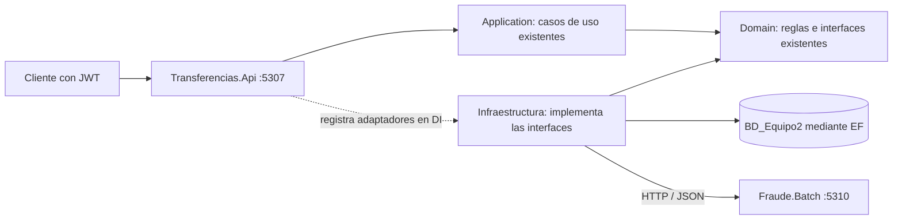

# Guía de la API de transferencias y el evaluador independiente

Abre **Transferencias.slnx** en la raíz de este repositorio. Todas las capas están
incluidas en src/; no necesitas clonar ni abrir el proyecto anterior.

Hay **dos servicios ejecutables**, con arranques y puertos propios. Las demás entradas
de la solución son bibliotecas de capas o proyectos de pruebas, no servicios adicionales.

| Servicio | Puerto | Responsabilidad |
|---|---:|---|
| `Transferencias.Api` | 5307 | Recibe solicitudes con JWT, invoca los casos de uso y conecta sus interfaces con infraestructura. |
| `Fraude.Batch` | 5310 | Evalúa una entrada JSON y devuelve una decisión. No conoce cuentas, clientes, JWT del cliente ni SQL. |

La API anterior `SystemAPI` y el evaluador anterior `FraudBatch` **no se necesitan
encendidos** para ejecutar esta solución. La API nueva no referencia a ninguno de ellos.
El evaluador nuevo tampoco referencia a la API, Application, Domain ni EF.

## Qué representa Clean Architecture aquí



El caso de uso sigue llamando `IAntifraudeService.EvaluarAsync`. No sabe qué URL hay,
cómo se serializa JSON ni cómo EF guarda filas. La implementación
`AntifraudeHttpAdapter` obtiene el historial, registra el intento, llama al evaluador
y guarda su respuesta o error. Cambiar ese proveedor manteniendo el contrato exige
cambiar el adaptador y su registro, no los controladores ni el caso de uso.

Para esta etapa se creó otra **presentación** con sus propios tres controladores y
configuración JWT. La presentación anterior permanece intacta. El archivo `Program.cs`
de la API nueva conecta las capas mediante inyección de dependencias; no contiene
reglas de saldo, comisión o fraude.

| Capa o carpeta | Contenido |
|---|---|
| `Transferencias.Api` | Tres controladores, JWT, Swagger, respuestas BIAN y manejo de indisponibilidad. |
| `src/Application` | Casos de uso y autorización por titular ya existentes; reutilizados sin cambios. |
| `src/Domain` | Entidades, reglas de transferencias e interfaces ya existentes; reutilizados sin cambios. |
| `Transferencias.Infrastructure` | Selección de adaptadores SQL/HTTP y simulaciones explícitas de OTP/cámara. |
| `src/SqlServerInfrastructure` | DbContext, mapeo de 11 tablas, repositorios EF, control de concurrencia y cliente HTTP. |
| `Fraude.Batch` | Contrato propio de entrada/salida y evaluador independiente. |
| `Taller.Tests` | Pruebas HTTP, JWT, errores, idempotencia y opción de integración SQL. |

## Flujo de una transferencia

1. La API valida firma, vigencia, emisor, audiencia y permisos del JWT.
2. Aplicación comprueba la titularidad y aplica las reglas existentes de cuenta, saldo y límite.
3. Infraestructura guarda la solicitud y el intento de evaluación en SQL.
4. Infraestructura envía al batchero referencia, monto, cantidad de débitos previos y destino conocido.
5. El batchero devuelve `Bajo`, `Medio` o `Alto`, con motivo y versión de regla.
6. Infraestructura registra la respuesta; Aplicación continúa, pide OTP o rechaza según sus reglas.
7. Si procede, se registra el movimiento local; se conservan estados, auditoría y avisos pendientes.

Si el evaluador cae, la API devuelve **503**, el intento queda en `Error`, la transferencia
en `NoDisponible` y no se debita dinero. Reintentar conserva la misma referencia. Si una
transferencia ya completada se reenvía, se devuelve su resultado sin duplicar el débito.

## Iniciar los dos servicios

Todos estos comandos se ejecutan desde **la raíz del repositorio**:

```powershell
dotnet build Transferencias.slnx -m:1
$token = ./scripts/nuevo-token.ps1 -Dni 12345678
```

La clave JWT pertenece a esta API y se guarda en User Secrets, fuera del repositorio.
Los tokens de `SystemAPI` no son intercambiables con los de esta API. Su vigencia es de
15 minutos; vuelve a ejecutar el script cuando caduquen. `-SoloLectura` limita el token
al permiso `transferencias.read`.

En una terminal:

```powershell
./scripts/iniciar-batch.ps1
```

En otra terminal:

```powershell
./scripts/iniciar-api.ps1
```

El script de la API recupera `ConnectionStrings__Transferencias` del entorno local o
del usuario de Windows. La configuración existente de este equipo se reutiliza sin
imprimir la contraseña. EF solo admite **BD_Equipo2**. El arranque no crea tablas,
ejecuta migraciones ni carga datos automáticamente. El modelo ER y scripts revisados
siguen en `database`; no hay que volver a ejecutarlos para iniciar la API.

- Swagger: `http://127.0.0.1:5307/swagger`. Pulsa **Authorize** y pega solo el token.
- Disponibilidad de la API: `http://127.0.0.1:5307/health/live`.
- Disponibilidad del evaluador: `http://127.0.0.1:5310/health`.
- Colección Postman propia: `contratos/Taller.postman_collection.json`. Configura
  `accessToken` localmente; no publiques ni guardes el token en Git.

## Endpoints de la nueva API

| Método y ruta | Función | Permiso |
|---|---|---|
| GET `/api/client/{nationalId}` | Consulta el cliente del token. | `transferencias.read` |
| GET `/api/account/{accountNumber}` | Consulta una cuenta propia. | `transferencias.read` |
| POST `/api/transactions` | Solicita una transferencia o confirma/reintenta la misma referencia. | `transferencias.write` |
| GET `/api/transactions/{transactionReference}` | Consulta el estado persistido de una operación propia. | `transferencias.read` |

Sin JWT válido: 401. Sin permiso: 403. Las consultas de recursos ajenos devuelven 404.
Los estados bancarios conservan el contrato BIAN existente: 200 completada, 202 pendiente,
409 confirmación/conflicto, 422 rechazada y 503 indisponibilidad.

## Batch: entrada y salida

El contrato está documentado en [contratos/fraude.md](../contratos/fraude.md). En el flujo
principal se consume por HTTP con `POST /api/fraud/evaluations`.

También puede ejecutarse como un proceso batch de **una entrada y una salida**,
sin levantar un servidor ni conectarse a ninguna base:

```powershell
Get-Content contratos/entrada-fraude.json -Raw |
  dotnet run --project src/Fraude.Batch --no-build --no-launch-profile -- --once
```

El modo `--once` lee stdin, escribe JSON en stdout y termina con código 0 (válido) o
2 (entrada inválida). La API consume la modalidad HTTP; no lanza un proceso por cada
transferencia. No se ha configurado un planificador ni una cola periódica.

## Pruebas

```powershell
# Sin acceso a SQL: API con almacenamiento sustituido en la prueba y batch HTTP real.
dotnet run --project tests/Taller.Tests --no-build

# Integración real: únicamente BD_Equipo2, con datos ficticios temporales propios.
dotnet run --project tests/Taller.Tests --no-build -- --sql-integration
```

La prueba SQL crea su propio segmento, cliente, cuenta y cuatro referencias aleatorias.
Verifica transferencias, idempotencia, rechazo, OTP, caída del batch, auditoría y avisos;
después elimina **solo sus filas** en `finally` y comprueba la limpieza. No utiliza
los saldos existentes del equipo. Si el proceso o el servidor se interrumpen por completo,
esa limpieza puede requerir revisión; los registros de prueba se identifican con `TST-`.
Se trata de movimientos contables ficticios, con cámara y OTP simulados.

Validación de la etapa de origen, realizada el **24/10/2026** (la validación de esta copia está en [VALIDACION.md](VALIDACION.md)):

- Compilación de la solución nueva: cero errores y cero advertencias.
- 103 comprobaciones de la API nueva con JWT y batch HTTP real, sin acceso a SQL.
- 17 comprobaciones de integración con SQL real en BD_Equipo2; limpieza verificada.
- Modo batch por stdin: salida correcta y código 2 ante entrada inválida.
- API iniciada como proceso independiente, con token real de desarrollo: cuenta propia
  200, cuenta ajena 404, sin token 401 y Swagger 200; estas verificaciones fueron de lectura.
- Las 353 comprobaciones anteriores continuaron pasando. Se compararon los archivos
  por SHA-256 y no hubo cambios en Application, Domain ni SystemAPI durante esta tarea.

El diseño de pruebas HTTP utiliza el [servidor de integración de ASP.NET Core](https://learn.microsoft.com/en-us/aspnet/core/test/integration-tests?view=aspnetcore-10.0).

## Estado de las actividades

| Actividad | Resultado |
|---|---|
| Modelo ER | Se reutiliza el modelo aprobado de BD_Equipo2. |
| Infraestructura EF | Conectada a la nueva API mediante los repositorios y mapeos existentes. |
| Script o batch antifraude | Nuevo ejecutable independiente: HTTP y `--once`. |
| Consumo de la respuesta | Cliente HTTP y persistencia de intentos/resultados/errores desde infraestructura. |
| JWT | Configurado para la nueva API, con titularidad y permisos de lectura/escritura. |

Para salir del taller siguen faltando identidad/login real, autenticación entre servicios,
OTP real, cámara real con conciliación y entrega efectiva de SMS/correo. Por eso ambos
servicios HTTP permanecen limitados a `Development`. Estas limitaciones no se ocultan
como integraciones reales.
